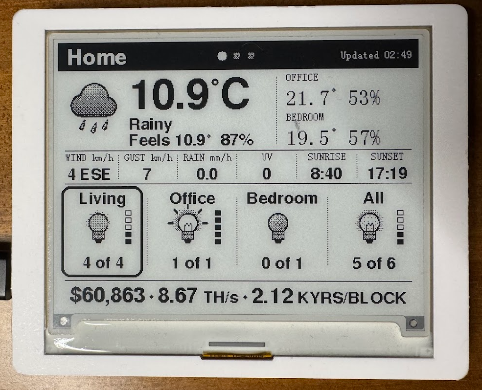
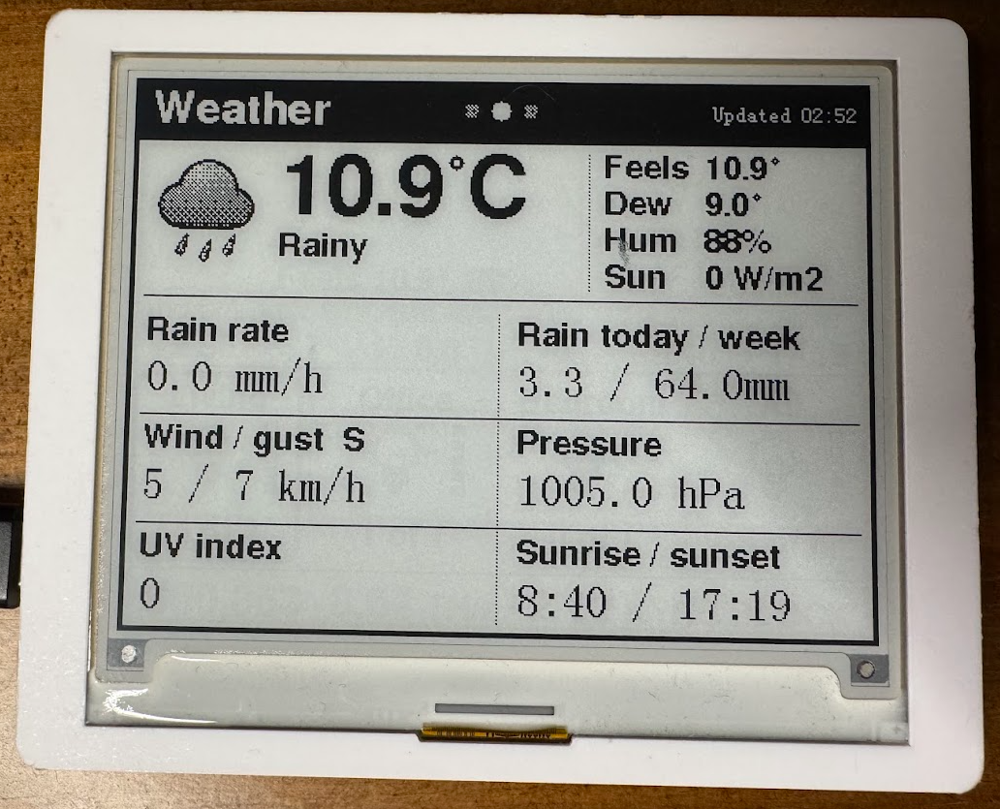
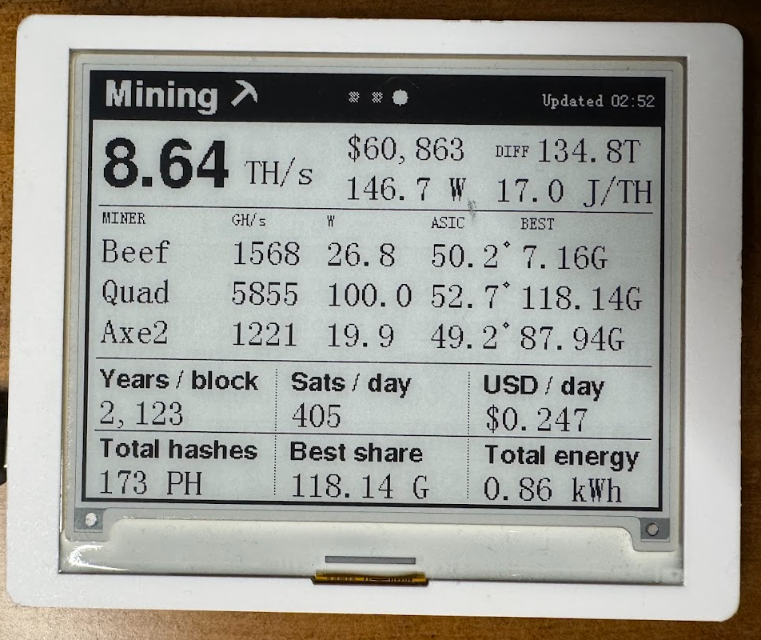
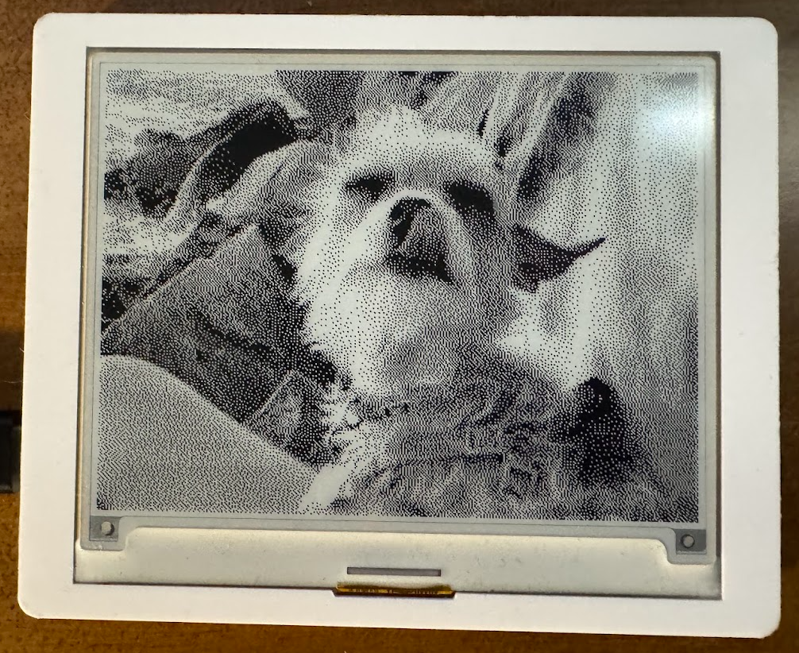

# Crow's Nest

An e-paper Home Assistant panel for the Elecrow CrowPanel 4.2".

A small e-paper wall panel for Home Assistant. It shows the things worth a glance (weather, which lights
are on, what the miners are doing) and lets you switch and dim lights from the wall. It runs on an
Elecrow CrowPanel ESP32-S3 4.2" and only refreshes the screen when something you can see has changed.

| Home | Weather | Mining | Easter egg |
|:---:|:---:|:---:|:---:|
|  |  |  |  |

This is the setup I use, published as a reference rather than a finished product. Yours will differ:
more or fewer rooms, one miner or none, a different weather station. Everything is configured in
`config.h`, and anything you leave out shows as `--`. The same approach (one template call to read,
service calls to act) works for anything Home Assistant controls, such as thermostats, fans or blinds.

---

## Features

- **Light control.** Toggle a room or all lights, step brightness through levels you choose, or hold
  EXIT to turn everything off. The "All" tile sets every lit light to the same level.
- **Immediate feedback.** The screen updates as soon as you press a button, then corrects itself if
  Home Assistant reports a different state.
- **Weather.** Temperature, feels-like, humidity, wind speed and direction, rain, UV, and sunrise and
  sunset, with dithered icons drawn for 1-bit.
- **Mining.** Fleet hash rate, Bitcoin price and difficulty, per-miner stats, estimated sats and USD per
  day, and expected years to find a block solo. Optional.
- **Easy on the display.** Redraws only when something visible changes, holds number-only updates to
  once every 10 minutes, and skips them overnight.
- **Low power.** Light-sleeps between polls, wakes on any button, and stays connected for 20 s after
  a press so follow-up presses are instant.
- **Reliable input.** Buttons are read on the second core, so presses during a refresh aren't lost.
- **Easter egg.** Press MENU and EXIT together.
---

## The screens

- **Home:** outdoor temperature and conditions, two indoor rooms, a weather strip (wind, gust, rain, UV, sunrise,
  sunset), up to five light tiles with brightness bars, and a mining line (Bitcoin price, hash rate, years to a block).
- **Weather:** feels-like, dew point, humidity, solar radiation, rain rate and totals, wind
  and gusts, pressure, UV, sunrise and sunset.
- **Mining** (optional): total hash rate, Bitcoin price and difficulty, power and efficiency, a per-miner table, plus
  expected years per block, sats/day, USD/day and lifetime hashes, best share and energy.

What does `KYRS/BLOCK` or `J/TH` mean? **[The screens](docs/screens.md)** explains every value and abbreviation.

---

## Using the panel

There are two focus modes.

**Lights mode** (Home page): a rounded box sits on one light tile.

| Input | Action |
|---|---|
| UP / DOWN | Move the box between the light tiles |
| MENU or rocker press (tap) | Toggle the boxed room |
| Hold MENU (or rocker press) + UP / DOWN | Next brightness level up / down |
| EXIT | Switch to page mode |

**Page mode**: a frame around the whole screen.

| Input | Action |
|---|---|
| UP / DOWN | Switch page: Home, Weather, Mining |
| MENU or rocker press | Go to Home and switch to lights mode |
| EXIT | Go to Home (stays in page mode) |

**Any time**

| Input | Action |
|---|---|
| Hold MENU 1 s | Full refresh (clears ghosting) and fetch fresh data |
| Hold EXIT 1 s | All lights off |
| MENU + EXIT together | Easter egg photo (yours from `easter_eggs.h`, or the bundled samples) |

MENU, EXIT and the rocker press act when released, so they can be held for brightness or a long press without
also triggering a tap.

The top-right corner shows when the displayed data was fetched (`Updated 14:32`). It switches to `Offline`
after two failed polls.

---

## The Easter egg

Press **MENU + EXIT** together and the panel shows a random photo of your choosing. It stays for a
minute, any button brings the dashboard back, and MENU + EXIT again shuffles to another (never the same one twice
in a row).

Photos are made with **[Image2Eink](Image2Eink/README.md)**, a browser tool in this repo: drop in pictures, crop
them, pick a dithering style, and export straight into the sketch folder. Nothing leaves your computer. A few sample
photos ship with the repo, so the egg works straight after cloning.

---

## Hardware

| Item | Detail |
|---|---|
| Board | Elecrow CrowPanel ESP32-S3 4.2" e-paper (SKU DIE07300S) |
| Display | 400 x 300, black and white, SPI |
| MCU | ESP32-S3, 8 MB flash, 8 MB OPI PSRAM |
| USB | USB-C through a USB-to-serial bridge on UART0 |
| Power | USB, always on. Light sleep keeps the draw down; there's no battery mode. |

**Buttons** (all active-low):

| Button | GPIO | Role |
|---|---|---|
| MENU | 2 | Act / toggle. Hold for a full refresh. |
| EXIT | 1 | Back / page mode. Hold for all lights off. |
| Rocker up | 6 | Previous tile or page, or brighter |
| Rocker down | 4 | Next tile or page, or dimmer |
| Rocker press | 5 | Same as MENU |

GPIO 7 enables panel power and is driven high at boot. GPIO 41 drives the power LED, set by `POWER_LED_MODE`.

---

## Get started

1. **[Setup](docs/setup.md):** Arduino IDE settings, `secrets.h`, `config.h` and flashing.
2. **[Home Assistant setup](docs/home_assistant_setup/home-assistant-setup.md):** create every entity the panel
   reads, with ready-to-copy YAML for the mining and Bitcoin parts.

## More docs

| Doc | What's in it |
|---|---|
| [The screens](docs/screens.md) | Every value on every page, and what it means |
| [Customising](docs/customising.md) | Timings, brightness levels, the power LED, buttons, layout |
| [Troubleshooting](docs/troubleshooting.md) | Common problems and fixes |
| [How it works](docs/how-it-works.md) | Refresh policy, ghosting, responsiveness, power |
| [Image2Eink](Image2Eink/README.md) | The photo converter for the Easter egg |

---

## Credits and licences

- **Vibe Coded** by Karl Diab.
- **Elecrow** for the CrowPanel e-paper driver (`EPD*.h/.cpp`, `EPD_font.h`), copied from their example code.
- **FreeSans fonts** from GNU FreeFont, converted to the Adafruit GFX format by the
  [Adafruit GFX Library](https://github.com/adafruit/Adafruit-GFX-Library) (BSD). `gfxfont_types.h` reproduces its font structs.
- **Image2Eink** uses [fflate](https://github.com/101arrowz/fflate) for ZIP handling.

Third-party files keep their original licences.
Everything else is released under the [MIT licence](LICENSE).
